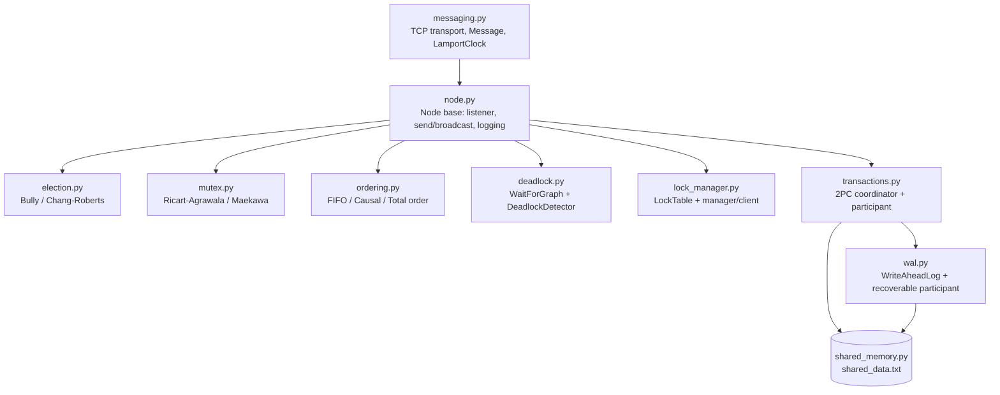

# Distributed Computing (course assignment)

A from-scratch toolkit of classic distributed-systems algorithms in pure Python
(stdlib only). Nodes are separate processes that talk over TCP sockets; a shared
JSON file (`shared_data.txt`) acts as distributed memory. Implemented: Lamport
and vector clocks, FIFO/causal/total-order multicast, Bully and Chang-Roberts
leader election, Ricart-Agrawala and Maekawa mutual exclusion, a shared/exclusive
lock manager, Two-Phase Commit with write-ahead-log recovery, and wait-for-graph
deadlock detection.

> **Context:** this is an educational project, written as a course assignment for
> "Computação Distribuída e Paralela" (Distributed and Parallel Computing) at UNESP. It favours clarity and testability
> over production robustness (no authentication, no handling of real network
> partitions, localhost-oriented ports). A technical report (in Portuguese) is in
> [`docs/REPORT.md`](docs/REPORT.md).

## Requirement labels (RF1..RF10)

The assignment listed functional requirements labelled `RF1`..`RF10`; these labels
appear in this README, the report, and the tests.

| Label | Requirement | Where |
|---|---|---|
| RF1 | Multicast communication with FIFO / causal / total ordering | `messaging.py`, `node.py`, `ordering.py` |
| RF2 | Coordinator election (Bully and Chang-Roberts) | `election.py` |
| RF3 | Mutual exclusion (Ricart-Agrawala and Maekawa) | `mutex.py` |
| RF4 | Lock manager with shared/exclusive locks | `lock_manager.py` |
| RF5 | ACID-style transactions over the shared file | `transactions.py`, `shared_memory.py` |
| RF6 | Wait-for graph, deadlock detection and resolution | `deadlock.py` |
| RF7 | Two-Phase Commit protocol | `transactions.py` |
| RF8 | Persistence and recovery after failures | `wal.py` |
| RF9/RF10 | Documentation and comparative analysis | `docs/REPORT.md` |

## Architecture



Every algorithm is a `Node` subclass exchanging typed JSON `Message`s stamped with
a Lamport clock; each node runs a listener thread and logs to `logs/node_{id}.log`.

---

## Requirements

- Python 3.10+
- No external runtime dependencies (stdlib only)
- `pytest` and `ruff` for development: `pip install -r requirements.txt`

---

## Project structure

```
distributed-computing/
├── src/                   # Algorithms (see table below)
├── tests/                 # pytest suite
├── docs/REPORT.md         # Technical report (Portuguese)
├── logs/                  # Per-node runtime logs (git-ignored)
└── pyproject.toml
```

| File | Responsibility |
|---|---|
| `messaging.py` | `LamportClock`, `Message`, `send_message`, `broadcast`, `start_listener` |
| `node.py` | `Node` base class: clock, listener thread, logger |
| `election.py` | `ElectionNode` (Bully), `ChangRobertsNode` (ring election) |
| `mutex.py` | `MutexNode` (Ricart-Agrawala), `MaekawaMutexNode` (quorum-based) |
| `ordering.py` | `VectorClock`, `FIFONode`, `CausalNode`, `TotalOrderNode` |
| `lock_manager.py` | `LockTable`, `LockManagerNode`, `LockClientNode` (shared/exclusive locks) |
| `transactions.py` | `TransactionCoordinator`, `TransactionParticipant` (2PC) |
| `wal.py` | `WriteAheadLog`, `RecoverableParticipant` (crash recovery) |
| `deadlock.py` | `WaitForGraph`, `DeadlockDetector` (DFS cycle detection) |
| `shared_memory.py` | `SharedMemory`: thread-safe JSON file key/value store |

Variant selection from the CLI: `python -m src.election cr ...` (Chang-Roberts),
`python -m src.mutex maekawa ...`, `python -m src.ordering <fifo|causal|total> ...`,
`python -m src.lock_manager <manager|client> ...`,
`python -m src.wal wal_participant ...`. See each module's `run_*` function for
the exact arguments.

---

## How to run each component

All demos require **separate terminals**. Nodes bind to `127.0.0.1:500{id}` (e.g.
node 0 → port 5000, node 1 → port 5001, node 2 → port 5002). Start nodes in
order and wait a moment for all listeners to come up before interacting.

### Messaging demo (RF1)

```bash
# Terminal 1
python -m src.node 0 0,1,2
# Terminal 2
python -m src.node 1 0,1,2
# Terminal 3
python -m src.node 2 0,1,2
```

Type any text in a terminal and press Enter to broadcast it to all peers. Each
node prints every message it receives along with Lamport clock values.

---

### Leader election — Bully algorithm (RF2)

```bash
# Terminal 1
python -m src.election 0 0,1,2
# Terminal 2
python -m src.election 1 0,1,2
# Terminal 3
python -m src.election 2 0,1,2
```

Node 2 (highest ID) wins the initial election. Kill node 2 with Ctrl-C, then
type `elect` in node 1's terminal — node 1 wins because no higher-ID node
responds within the timeout.

---

### Mutual exclusion — Ricart-Agrawala (RF3)

```bash
# Terminal 1
python -m src.mutex 0 0,1,2
# Terminal 2
python -m src.mutex 1 0,1,2
# Terminal 3
python -m src.mutex 2 0,1,2
```

Type `acquire` in two terminals simultaneously. Only one node enters the
critical section at a time; the other waits until the first releases it.
The acquiring node holds the CS for 2 seconds before releasing automatically.

---

### 2PC Transactions — shared memory (RF5/RF7)

```bash
# Terminal 1 — coordinator
python -m src.transactions coordinator 0 0,1,2 1,2
# Terminal 2 — participant
python -m src.transactions participant 1 0,1,2
# Terminal 3 — participant
python -m src.transactions participant 2 0,1,2
```

Type `transact` in the coordinator terminal, enter a key and a value when
prompted. The coordinator runs a full PREPARE → VOTE → COMMIT/ABORT cycle.
On COMMIT, all participants write the key/value to `shared_data.txt`.

---

### Deadlock detection — wait-for graph (RF6)

```bash
# Terminal 1 — detector
python -m src.deadlock 0 0,1,2 detector
# Terminal 2 — worker
python -m src.deadlock 1 0,1,2 worker
# Terminal 3 — worker
python -m src.deadlock 2 0,1,2 worker
```

In the worker terminals, simulate a circular dependency:

```
# Worker terminal 2
wait T1 T2

# Worker terminal 3
wait T2 T1
```

The detector broadcasts `DEADLOCK_DETECTED` with the cycle and the chosen
victim (highest transaction ID in the cycle). Type `graph` in the detector
terminal to inspect the current wait-for adjacency list.

---

## Running tests

```bash
python -m pytest tests/ -v
```

---

## Logs

Each node writes structured log records to `logs/node_{id}.log`. Log entries
include the node ID and current Lamport clock value in the format:

```
[node 0][3] INFO RECV from node 1 | type=COORDINATOR ...
```
